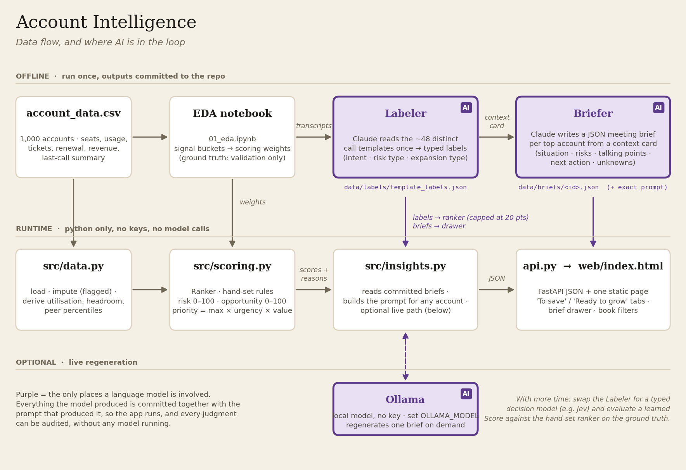

# How AI was used

A short overview. The detailed reasoning is in [decisions.md](decisions.md);
the picture is [architecture.png](architecture.png).

## The principle

A language model is used in exactly two places, both offline, and everything
it produced is committed to the repo together with the prompt that produced
it. The app runs with no API key and no model call, and every AI judgment can
be read and audited as a file. Scoring and ranking are deliberately **not**
done by the model: they are hand-set rules an Account Executive can read
aloud and the panel can challenge line by line.

## Where the model is in the loop

**1. Labeler** (`src/labeler.py`, `src/prompts.py::LABELER_PROMPT`)
The 948 call summaries in the dataset collapse to about 48 distinct
templates. Claude read each template once and returned typed labels: intent
(`risk` / `growth` / `neutral`), risk type (budget, competitor, champion
left, support escalation, ROI doubt, consolidation) and expansion type
(seats, new team, module), with a confidence and a one-line rationale.
Those judgments live in `data/labels/template_labels.json` and are expanded
to all 1,000 accounts mechanically. In the ranker the label is a real
feature, capped at 20 of 100 points so a single sentence on a call can never
outvote three numeric signals. With labels in, top-decile risk recall went
from 64% to 71% on the held-out ground truth.

**2. Briefer** (`src/insights.py`, `src/prompts.py::BRIEF_PROMPT`)
For each account in the default view (22 in total) Claude wrote a meeting
brief from a *context card*: the account's facts, its score breakdown with
reason codes, and segment medians for peer comparison. The brief is a fixed
JSON schema — situation, risks, opportunities, three talking points, next
action, and *unknowns* (what the data cannot tell us, which doubles as the
AE's question list). The prompt forbids numbers not on the card and
invented names or dates; a test checks that every risk and opportunity
bullet cites a number or a call signal. Each brief in `data/briefs/` carries
the exact prompt and card it came from, and the UI shows them under
"Prompt and context card sent to the model".

## Where the model is not

The **ranker** (`src/scoring.py`) is a rule table lifted from the EDA
notebook: seat utilisation, days since last sales touch, open tickets, AI
feature adoption, plus the capped transcript label. Risk and opportunity are
scored 0–100 separately; a priority key (`max(risk, opportunity) × renewal
urgency × log revenue`) orders the lists. A logistic regression was fit only
as a sanity check that the hand weights point the same way.

## Live regeneration (optional)

`src/insights.py` can call a local Ollama model if `OLLAMA_MODEL` is set, so
a reviewer can regenerate a brief for any account without a key. Without it,
the drawer shows the assembled prompt so it can be pasted into any model.

## With more time

Swap the labeler for a typed decision model such as Jev (cheap, probabilistic,
built for classification), and evaluate a learned score against the hand-set
ranker on `revenue_end_of_quarter`. Neither can write the brief; that stays
generative.

## How the repo was built with Claude

The repo was built in a Claude (Cowork) session over two days, with the human
deciding and reviewing at each step. The log below is the condensed version:
one line per interaction that changed the outcome. Skills are the named
workflows invoked inside the session.

| # | What I asked | Skill / tool | What came out |
|---|---|---|---|
| 1 | Read the brief and tell me exactly what has to be delivered, then propose a high-level design. | Document reading, data profiling, inline architecture diagram | The four-layer design (data → scoring → insight → UI), plus two data traps found before any code: `NA` = North America parsed as null, and `revenue_end_of_quarter` is a leaked future outcome. |
| 2 | Should we grill-me the design or iterate on a draft? | — | Advice: draft first, grill later on the scoring rationale. |
| 3 | Create the folder structure, do the EDA, and set up GitHub under a different account than the one logged in. | Jupyter notebook built and executed; `git`; built-in browser for the GitHub sign-in | Repo scaffold, `notebooks/01_eda.ipynb` with 8 figures, repo pushed from my own terminal so credentials never passed through the session. |
| 4 | Grill me on scoring, LLM use (incl. the Jev idea) and the UI, max 20 questions. | `grill-me` skill, web search on Jev | Nine locked decisions in `docs/decisions.md`: labeler → ranker → briefer, capped label weight, two scores, urgency ≠ risk, no industry prior, no API keys, brief schema with `unknowns`, filters as the AE's book, two screens. |
| 5 | Implement the data and scoring layers against those decisions. | Python, tests run in-session | `src/data.py`, `src/scoring.py`, 11 tests, ground-truth validation (top risk decile = 64% of churn vs 8% for a revenue sort), logistic-regression sanity check. |
| 6 | Generate the transcript labels (no API keys; use the session itself as the model). | Claude as labeler | 48 templates labelled with rationale in `data/labels/template_labels.json`; expanded to all accounts; discovered the labels are a perfect oracle in this synthetic data and recorded why the cap matters. |
| 7 | Generate the meeting briefs and the insight layer. | Claude as briefer; grounding test | 22 briefs committed with prompt and context card; the grounding test failed on three of Claude's own bullets and the briefs were fixed, not the test. |
| 8 | Build the UI. | Streamlit, browser review of my running app | First version: one mixed table with score bars. |
| 9 | "I'm confused: what is the ranker, why is risk on row 1 and opportunity on row 2, what is the graph?" | — | Plain-English explanation of the two scores and the priority key; UI split into *To save* and *Ready to grow*, each sorted by its own number. |
| 10 | "I still don't love it, and the grow list is too low. I'm hating Streamlit." | `frontend-design` skill | Streamlit removed; FastAPI + a single-page web UI with the two lists side by side and the brief in a drawer. |
| 11 | Add a document on how the LLM was used, with a table of the interactions. | — | This file. |

What this log is meant to show the panel: the model wrote code and text
quickly, but every decision that matters (what to score, what to cap, what
not to build) was made in conversation and is written down with its
rejected alternatives.
